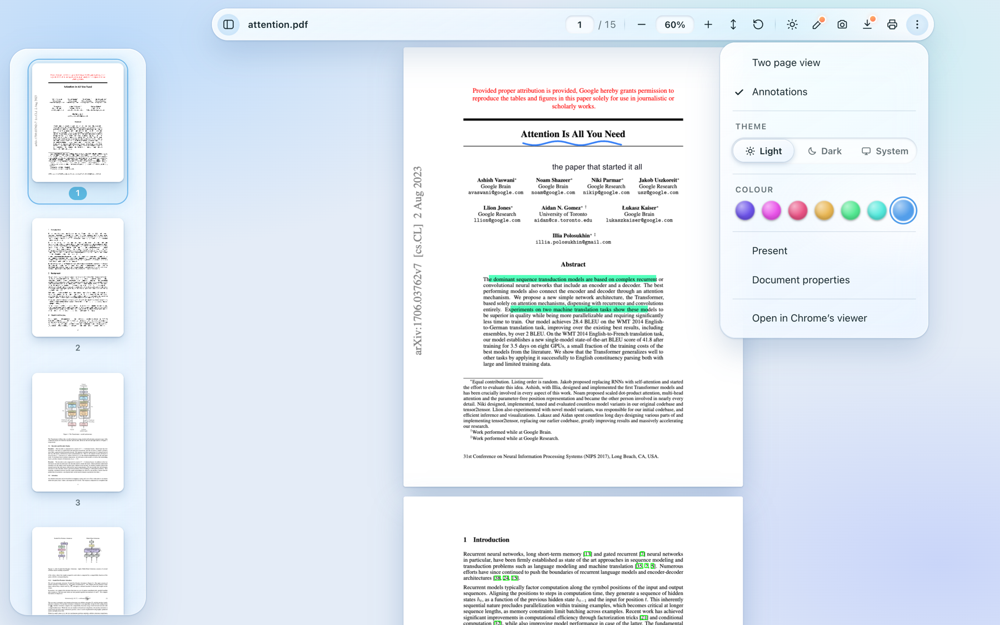
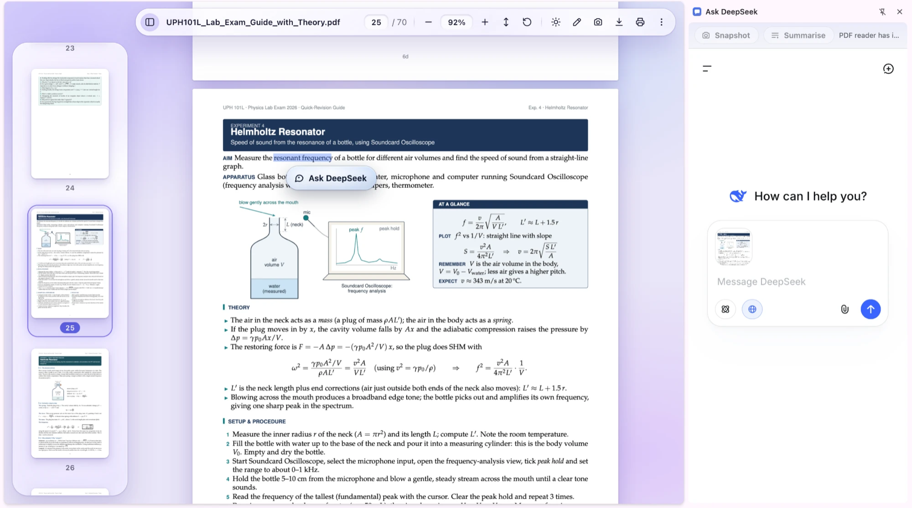
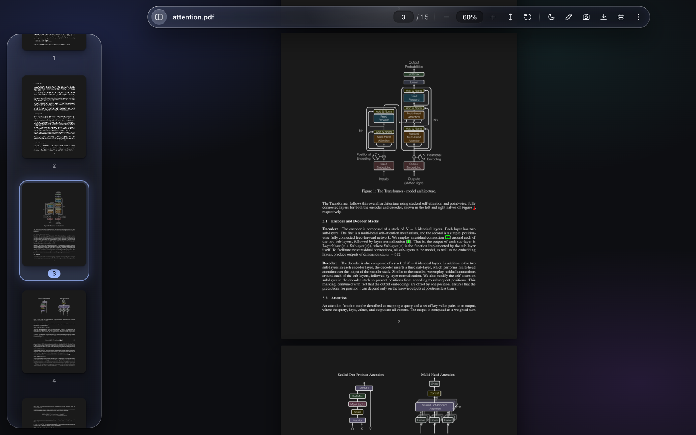
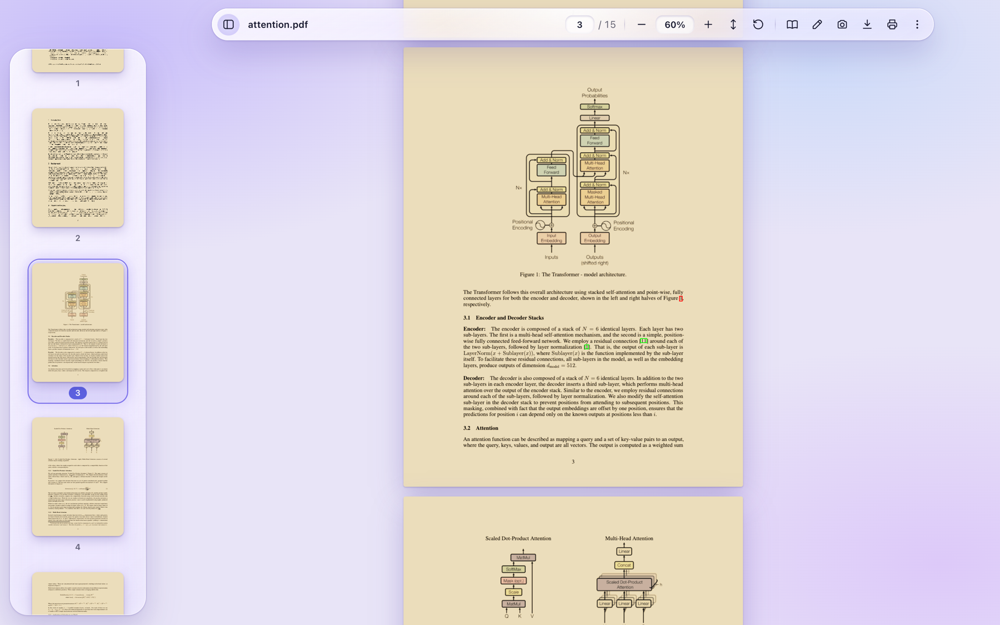
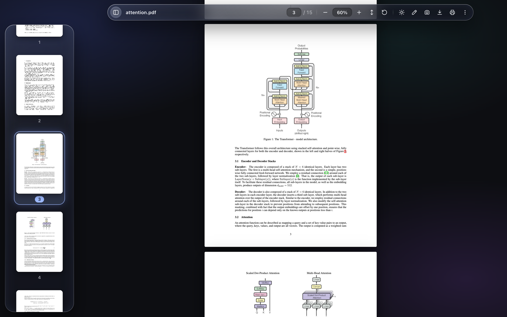
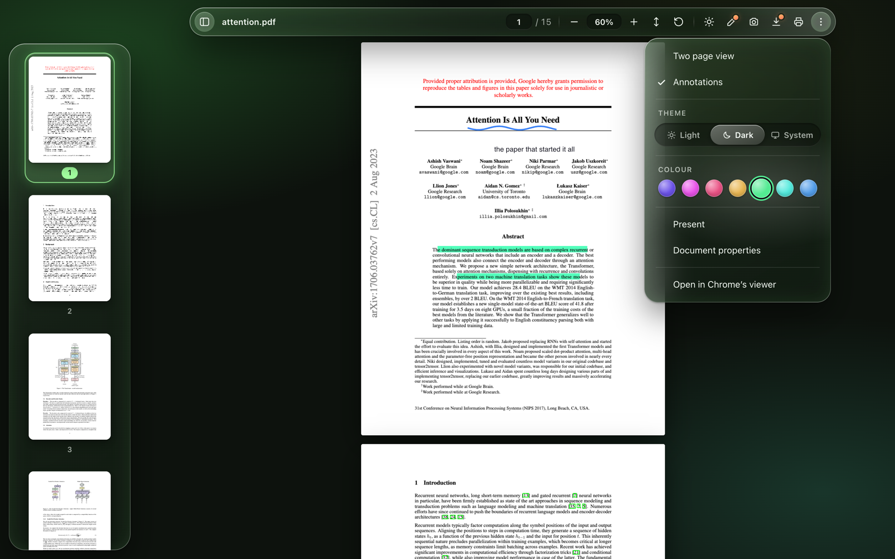
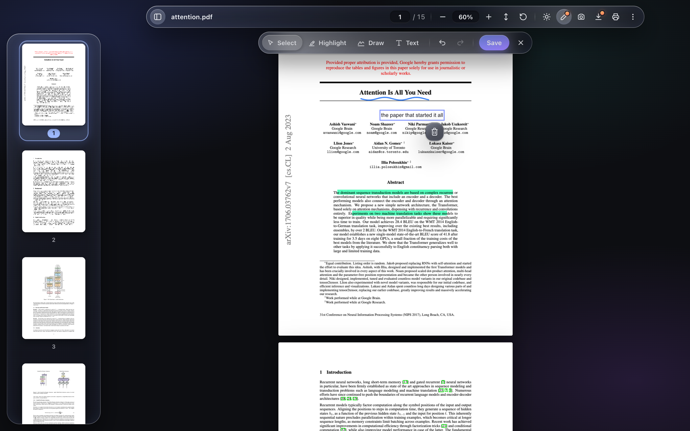

# Ask LLM

> **Heads up:** a lot of vibe coding went into this extension. I shaped it around my own taste, mainly to fix the things I
> found annoying about Chrome's built-in PDF viewer. I built it for personal use only, but other people might find it
> useful too, so I put it on GitHub. Issues and pull requests are welcome.

A Chrome extension that puts an AI chat in your side panel (DeepSeek, Claude, ChatGPT or Gemini, your pick) and makes it
easy to ask about whatever you're reading.

Select some text on any page, click the small **Ask** button that pops up, and the text lands in the chat's message box.
You write your question and press send yourself. The extension never sends anything for you.

It also comes with its own PDF reader, because Chrome's built-in one can't talk to extensions.

## How it works, and what it costs you

There's no API key and no server in between. The side panel simply shows the chat website itself (chat.deepseek.com,
claude.ai, chatgpt.com or gemini.google.com), signed in with **your own account**, exactly as if you had it open in a tab.

So usage works the same as on the website:
- Whatever your account gets on that site is what you get here: same models, same history, same limits.
- Free accounts hit the site's normal free limits (Claude, ChatGPT and Gemini all cap free use). Paid plans work as usual.
- **DeepSeek is the default because in practice its free web chat is basically unlimited** for normal use.
- Your chats show up in that site's history like any other chat.

Not affiliated with DeepSeek, Anthropic, OpenAI or Google. It just embeds their public chat sites.

## Install

You don't need the Chrome Web Store or any coding. It takes about a minute.

1. **Get the files.** On this page click the green **Code** button, then **Download ZIP**. Unzip it somewhere you won't
   delete it later (the extension runs from that folder). If you use git: `git clone https://github.com/sitarampujyam/ask-llm.git`
2. In Chrome, open `chrome://extensions` (paste it in the address bar).
3. Turn on **Developer mode** (switch at the top right).
4. Click **Load unpacked** and pick the folder that contains `manifest.json`.
5. Click the puzzle-piece icon in the toolbar and pin **Ask LLM**.
6. Click the extension icon. The side panel opens with DeepSeek. Sign in once. To use another chat, pick it from the
   menu at the top left of the panel and sign in to that one too.
7. Refresh any tabs you already had open. Extensions only attach to pages loaded after they're installed.
8. Want it on local PDFs (files on your computer)? On the extension's card in `chrome://extensions` click **Details** and
   switch on **Allow access to file URLs**.

Needs Chrome 114 or newer. Other Chromium browsers (Edge, Brave, Arc) should work the same way, but I've only tested Chrome.

To update later, replace the folder with the new download and press the reload arrow on the extension's card.

## How to use it

- **Pick your chat:** the menu at the top left of the side panel switches between DeepSeek, Claude, ChatGPT and Gemini.
  The panel remembers your last pick.
- **Ask about text:** open the side panel (click the icon, or press `Option+D` on Mac / `Alt+Shift+D` elsewhere), select
  text on any page, click the button that appears. Press the shortcut again to close the panel.
- **Ask about a PDF:** open any link ending in `.pdf`. It opens in the reader. Select text there and the button always
  shows, even if the panel is closed (it opens the panel for you).
- **Snapshot:** click the camera in the reader's toolbar, or the camera at the top of the side panel, to attach a picture of what's on screen.
- **Summarise:** the Summarise button in the side panel pastes the active tab's text and a screenshot, with a short instruction to summarise it.
- **Reload:** the round arrow at the top of the panel reloads the chat, which clears a stuck sign-in or a bot check.

## Features

**Asking**
- Floating glass button on selected text, on every normal web page (while the panel is open) and always in the PDF reader.
  It's labelled with the chat you picked: Ask DeepSeek, Ask Claude, Ask ChatGPT or Ask Gemini.
- Fills the message box and puts the cursor at the end. Never presses send.
- Adds a source line with the page title, the PDF page number and the link. A second selection is appended below the first.
- Starts the box with a short instruction to explain the text plainly. Add your own question and it follows that instead.
  For Claude the intro is shorter still: answer the question if there is one, otherwise explain the text.
- Works inside the chat too: select part of one of its replies and the same button appears. The text goes into the
  message box introduced as coming from the earlier response, so you can ask a follow-up about just that bit. Can be
  turned off in Options.
- Snapshot of the visible part of a page or PDF, attached as an image. Each site takes images differently (paste, the
  attach button, drag and drop), so it tries those in turn and stops at the first one that works. If a site still refuses,
  the image goes on your clipboard and the panel tells you to press ⌘V. It's held in memory only, never saved to disk.
- Summarise button for web pages: page text plus a screenshot.
- Rejects cookie banners for you (DeepSeek: "Necessary cookies only", Claude: "Reject"), since the sites can't remember the choice inside a panel and would ask every time.
- If a chat refuses to load inside the side panel, the panel offers a docked popup window and everything works there.
- Right-click a link or page, **Open in Ask LLM reader**, for PDFs that don't end in `.pdf`.
- The panel's top bar is a floating liquid-glass pill, nothing else. It sits on the chat's own background colour and turns light or dark to match the chat.

**PDF reader**
- Continuous scrolling, page counter, jump to page by typing a number.
- Zoom with the buttons, a typed percentage, `Ctrl`/`Cmd` plus `+`, `-`, `0`, pinch or `Ctrl`+scroll. Fit to page or fit to width.
- Rotate pages.
- Thumbnail panel on the left that follows your scrolling.
- Two-page view.
- Page colours: Original, Dark, Sepia. Only the pages change.

- Light, Dark or System theme for the reader itself.
- Seven colour themes (Violet, Magenta, Rose, Amber, Emerald, Teal, Ocean), under the three-dots menu.

- Present mode (fullscreen, arrow keys or space to turn pages).
- Print, download, document properties, password-protected PDFs.
- Opens big files quickly: loads the PDF in pieces, draws visible pages first.
- Remembers the page, scroll position, zoom and rotation you left each PDF at. A link ending in `#page=5` overrides it.
- Switch to Chrome's own viewer for the current file at any time.

**Annotating** (pen button in the reader)

- Highlight text, or drag over empty space to highlight freehand.
- Draw with a pen, set colour and thickness.
- Type text boxes, set colour and size.
- Select tool to move, resize or delete marks. Draw and Text never grab old marks, so you can draw right over them.
- Undo and redo.
- Marks stay in the tab until you save, like Chrome's viewer. An orange dot warns you about unsaved changes, and closing the tab asks first.
- Download either a copy with your marks (real PDF highlight, ink and text annotations, so other PDF apps see them) or the untouched original.
- Marks show up in prints and snapshots.

## Privacy

Selected text, the page title and the link only ever go into the chat's message box on your own screen. They leave your
browser when you press send, not before, and then they go to that chat's company, the same as typing it yourself. There is
no analytics, no tracking and no server of mine. The only network traffic is the PDF you open and the chat site itself.

Reading position and settings are stored in your browser. Options has a switch to stop remembering positions and a button to wipe them.

## Why it asks for those permissions

| Permission | Why |
|---|---|
| Access to all sites | To show the Ask button on whatever page you're on, and to read PDFs from any link. |
| `sidePanel` | The chat side panel. |
| `declarativeNetRequest` | The chat sites normally refuse to be embedded in other pages. A rule removes the `X-Frame-Options` and `Content-Security-Policy` headers, only on their frames inside this extension's panel. It touches nothing else. |
| `storage` | Your settings. |
| `contextMenus` | The right-click "Open in Ask LLM reader" entry. |
| `webNavigation`, `scripting` | Catching `.pdf` links and tracking the panel's open state. |

## Options

Open the extension's options page (right-click the icon, then Options):
- Open PDF links in the reader (on by default). Turn it off to use Chrome's viewer again.
- Remember where I stopped in each PDF.
- Show the Ask button when selecting text in the chat's replies (on by default).
- Forget all saved positions.

## If a chat site changes

The button fills the message box by looking for it on the page. If a site redesigns and filling stops working, the
selectors live in `selectors.js`, in one place, and are easy to update. The list of sites, and how each one takes
images, is in `providers.js`.

## Limits

- Scanned PDFs have no text to select, so highlighting and asking won't work on them.
- Existing annotations already inside a PDF can't be edited yet, and you can't insert images.
- Chrome doesn't let extensions run on `chrome://` pages, the Web Store or Chrome's built-in PDF viewer.
- The chat sites run their own bot checks. If one gets stuck inside the panel, press Reload or use the popup window.

## Files

| File | What it does |
|---|---|
| `viewer.html`, `viewer.js`, `viewer.css` | The PDF reader |
| `sidepanel.html`, `sidepanel.js`, `sidepanel.css` | The side panel: chat picker, Snapshot, Summarise, Reload |
| `background.js` | Header rule, PDF interception, shortcut, message routing |
| `page-button.js` | The floating button on pages and in the reader |
| `content.js` | Runs inside the chat sites, fills the message box and attaches snapshots |
| `selectors.js` | Everything that depends on the chat sites' page layout |
| `providers.js` | The list of chat sites and how each takes images |
| `options.html`, `options.js` | Settings |
| `lib/` | PDF.js 4.10.38 (Apache-2.0), bundled so nothing is downloaded |

## License

MIT, see `LICENSE`. PDF.js in `lib/` is Apache-2.0.
